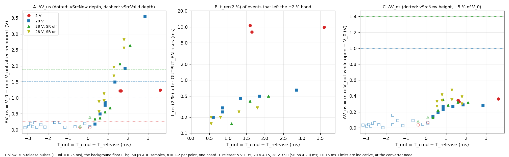

# Test report: Q5/Q6 load drop and reconnect, converter-node response at 5, 20 and 28 V

| Field | Entry |
|---|---|
| Report date | 2026-10-19 |
| Test dates | 2026-10-17 11:09–17:14 EDT (README steps 2–9); 2026-10-18 09:07–09:16 EDT (step 10) |
| Test engineer | Claude Code, driving the bench through `tools/bringup` (`bu`) |
| Bench operator | Dan: wiring, load, scope probes, approvals |
| Prepared for | Dan (design engineer) |
| DUT | One PD_Charger board (serial not recorded): STM32G474 four-switch buck-boost, 24.56 V input |
| Firmware | Commit `da5a649c204bee4715621c1132f94908d8161f5e`; `final.elf` sha256 `eb49b8f6838957be694bca1e9513207d2c085c8f1ef6d72a25eae81007891885`. Runs 1–3 used an earlier build: binary kept as `data/firmware/final_runs1-3_flashed_20261017-130638.bin` (sha256 `a1753b1e…91692`), source tree not committed (§3.3) |
| Data | `report/pulse_metrics.csv`: 43 pulses × 34 columns (committed). Raw traces in `data/` (git-ignored, bench machine) |
| Generated tables | Blocks marked `gen:NAME` are written by `scripts/pulse_metrics.py update` from the raw data (§11) |
| Status | Characterisation. No acceptance limits were fixed before the tests. USB PD limits are indicative (§2.5). Requirement register: `plans/stability-requirements.md` (cited as register IDs A1…F6) |
| Plan change | The planned load-step and contract-change transients could not be run: the QT Py buck used as the load did not convert (README step 3). The stimulus became the Q5/Q6 drop-and-reapply of §2.1 (L14) |

## 1. Objectives and results

| ID | Objective | Result in |
|---|---|---|
| O1 | Q5/Q6 release lag T_release at 5, 20, 28 V | §6.1 |
| O2 | Background excursion E_bg of V_out with the load connected | §6.2 |
| O3 | ΔV_os, ΔV_us, t_min, t_rec(2 %) against the unloaded interval T_unl | §6.3, §6.4 |
| O4 | Control behaviour after the event: kp, command ceiling, ringing, windup | §6.5 |
| O5 | Effect of the synchronous rectifier (SR) at 28 V | §6.6 |
| O6 | Indicative comparison with USB PD vSrcNew / vSrcValid | §6.7 |

<!-- BEGIN gen:summary -->
| Quantity | 5 V buck, SR off | 20 V buck, SR off | 28 V buck-boost, SR off | 28 V buck-boost, SR on |
|---|---|---|---|---|
| Pulses: sub-release + events | 5: 2 + 3 | 22: 15 + 7 | 8: 2 + 6 | 8: 0 + 8 |
| T_release used (ms) | 1.35 | 4.15 | 3.90 | 4.20 (TP2 scope) |
| E_bg: largest ΔV_us of a sub-release pulse (V) | 0.09 | 0.24 | 0.39 | no control pulses |
| Events with T_unl ≥ 0.5 ms: n; T_unl (ms) | 3; 1.60 to 3.60 | 6; 0.60 to 2.85 | 5; 0.60 to 2.10 | 8; 0.55 to 1.80 |
| ΔV_us of those events (V) | 1.22 to 1.24 | 0.50 to 3.55 | 0.37 to 2.63 | 0.57 to 2.82 |
| ΔV_us / V_0 (%) | 24.4 to 24.8 | 2.5 to 17.7 | 1.3 to 9.4 | 2.0 to 10.1 |
| Slope of ΔV_us on T_unl (V/ms) | — | 1.33 | 1.65 | 1.59 |
| …of which at background level (ΔV_us ≤ E_bg of that voltage, t_min > 1 ms) | 0 | 0 | 1 | 0 |
| t_min after the reconnect sample (ms), events above background | 0.40 to 0.70 | 0.10 | 0.10 | 0.10 |
| t_rec(2 %) (ms), events above background | 8.05 to 10.65 | 0.20 to 0.65 | 0.15 to 0.50 (1 of 4 never left the band) | 0.15 to 0.30 |
| ΔV_os while open (V) | 0.33 to 0.36 | 0.19 to 0.29 | 0.22 to 0.35 | 0.27 to 0.47 |
| V_min beyond vSrcValid, events with a retained trace | 3 of 3 | 2 of 5 | 2 of 5 | 3 of 8 |
| T_unl (ms): last event within vSrcValid / first beyond | — / 1.60 | 1.35 / 1.85 | 1.10 / 1.60 | 1.30 / 1.30 |
| Railed samples per event trace | 0 | 0 | 0 to 9 | 0 to 1 |
| σ_pre over all pulses, mV: mean (min–max) | 17 (16–19) | 26 (20–32) | 31 (29–35) | 72 (61–80) |
<!-- END gen:summary -->

| # | Result | Values | § |
|---|---|---|---|
| 1 | Q5/Q6 keep the load on V_out after OUTPUT_EN falls | T_release 1.35 / 4.15 / 3.90 ms at 5 / 20 / 28 V (SR off); 4.20 ms at 28 V SR on (one TP2 pulse); ±0.15 ms. Sub-release pulses (T_unl ≤ 0.25 ms; n = 2 / 15 / 2) show ΔV_us up to 0.09 / 0.24 / 0.39 V (E_bg) at 5 / 20 / 28 V | 6.1, 6.2 |
| 2 | ΔV_us rises linearly with T_unl at 20 and 28 V | 1.33 V/ms (n = 6), 1.65 (n = 5), 1.59 (n = 8, SR on); largest 3.55 V (17.7 %) at 20 V, 2.63 V (9.4 %) at 28 V SR off, 2.82 V (10.1 %) at 28 V SR on | 6.3 |
| 3 | At 20 and 28 V the minimum is reached 0.10 ms after the reconnect sample and recovery is fast | t_min 0.10 ms; t_rec(2 %) 0.15–0.65 ms | 6.3 |
| 4 | At 5 V ΔV_us does not depend on T_unl and recovery is slow | 1.22–1.24 V (24.4–24.8 %) for T_unl 1.60–3.60 ms; t_rec(2 %) 8.05–10.65 ms | 6.3 |
| 5 | V_out rises little while the load is off | ΔV_os 0.19–0.47 V; I_cmd −4.1…+0.1 %; skipping 0–4 samples at 20/28 V, 18–60 at 5 V | 6.4 |
| 6 | No ringing, limit cycle or windup above background after the event | rms(V_out − V_0)/σ_pre 0.8–1.3 from 10 ms on; I_cmd tail −2…+4 mA | 6.5 |
| 7 | SR on against off at 28 V is not resolved | ΔV_us difference −0.24…+0.34 V against repeat sd 0.19 V; σ_pre 31 → 72 mV (×2.3); railed samples per pulse 1/3/7/9 → 0/0/0/1 at T_cmd 4.75/5.0/5.5/6.0 ms | 6.6 |
| 8 | Against indicative PD limits at the converter node | V_min beyond vSrcValid in 3/3, 2/5, 2/5, 3/8 events; time between vSrcNew and vSrcValid ≤ 0.90 ms; ΔV_os above +5 % only at 5 V | 6.7 |
| 9 | The ΔV_us mechanism is not established | passive charge-sharing prediction ÷ measurement 1.2–14.7 (C_L 100–120 µF) and 0.7–6.2 (C_L 271 µF) | 10 |
| 10 | The Q5/Q6 flag schedules the loop gains as coded | I_cmd over the open interval rebuilt with the open gains: 0.25–0.61 mA rms in all 41 retained traces; with the closed gains 3.06–40.29 mA rms | 6.5 |
| 11 | V_out excursions of more than 0.25 V below V_0 at constant load occur at 28 V, more often with SR on, and not at 5 or 20 V | 47 events (83 samples) in 638 ms with SR on; 4 (7) in 643 ms with SR off; 0 in 412 ms (5 V) and 1636 ms (20 V); deepest −0.50 V | 6.2 |
| 12 | The 50 µs trace sample underreads the fast minimum of ΔV_us | One 28 V SR-on pulse: 2.50 V (50 µs sample), 2.67 V (5 µs scope mean), 3.01 V (1 µs mean) | 6.8 |

## 2. Definitions

### 2.1 Event sequence

OUTPUT_EN is the firmware's gate-drive enable for Q5/Q6 (GPIO `OUTPUT_EN_PC8`). The test lowers it for T_cmd (set by TIM4) and records V_out at 20 kHz.

| Phase | Interval | OUTPUT_EN | Load on V_out | V_out | Quantity |
|---|---|---|---|---|---|
| Pre-event | −7.35 ms … 0 | high | yes | regulated at V_0 | V_0, σ_pre |
| Release lag | 0 … T_release | low | yes (Q5/Q6 still conduct) | unchanged, within E_bg | T_release |
| Load off | T_release … T_cmd | low | no; R ‖ C_L discharges toward 0 V | rises slowly | T_unl = T_cmd − T_release; ΔV_os |
| Reconnect | T_cmd | rising | Q5/Q6 turn on; the partly discharged load side is attached | falls | ΔV_us at t_min |
| Recovery | T_cmd … T_cmd + t_rec | high | yes | returns to V_0 ± 2 % | t_rec(2 %) |

```
time        0               T_release                  T_cmd                T_cmd + t_rec
OUTPUT_EN   high | low ..................................... | high .........................
load side   on V_out ........| off V_out, R ‖ C_L discharges  | on V_out (Q5/Q6 hot-attach)
                             |<------------ T_unl ---------->|
V_out       V_0 .............| slow rise, ΔV_os              | falls by ΔV_us at t_min,
                             |                               | back inside V_0 ± 2 % at t_rec(2 %)
```

### 2.2 Terms

| Term | Definition | Obtained from | Resolution, limits |
|---|---|---|---|
| V_0 | Mean V_out over the 147 samples (7.35 ms) before the trigger | regulator trace | ADC LSB 17 mV |
| σ_pre | Population sd of those samples | trace | 16–35 mV SR off, 61–80 mV SR on |
| T_cmd | Time OUTPUT_EN is low. TIM4 one-pulse, 1 µs ticks; the trace reports request + 1.4 µs (DWT, 170 MHz) | TIM4, DWT | ±1 µs. Runs 1–3: reconnect-sample time (50 µs) |
| T_release | OUTPUT_EN falling until the load leaves V_out (V_out rises out of the noise) | ensemble of traces (§5.3); TP2 scope for 28 V SR on | ±0.15 ms |
| T_unl | T_cmd − T_release: the interval in which the load is off V_out. Assumes Q5/Q6 turn on promptly (not measured) | derived | ±0.15 ms |
| Sub-release pulse | T_unl ≤ 0.25 ms: the load never left V_out | derived | |
| Event; real event | T_unl > 0.25 ms; T_unl ≥ 0.5 ms (the set used for fits) | derived | |
| Reconnect sample | First PID cycle after OUTPUT_EN rises (the trace flag is the firmware flag, not the switch) | trace | ≤ 50 µs |
| ΔV_os | max V_out from the trigger sample to the reconnect sample, minus V_0 | trace | includes E_bg |
| ΔV_us | V_0 − min V_out from the reconnect sample to the end of the 95 ms record | trace, one 50 µs sample | 50 µs averaging underreads fast minima (§8) |
| t_min | Reconnect sample to the minimum | trace | 50 µs |
| t_rec(2 %) | Reconnect sample to the last sample outside V_0 ± 2 %, plus one sample. "—": the band was never left | trace | 50 µs |
| E_bg | Largest ΔV_us among sub-release pulses at that voltage: the response when nothing was disconnected | trace | n = 2 / 15 / 2 (5 / 20 / 28 V SR off) |
| Background-level event | ΔV_us ≤ E_bg and t_min > 1 ms | derived | |
| Railed sample | I_cmd ≥ I_max − 2 mA: the loop command at its ceiling | trace | |
| Time below 0.95 V_nom; below vSrcValid | 50 µs × samples after the reconnect below that level | trace | 50 µs |

Percentages are of V_0. A ±5 % band is 0.25 / 1.0 / 1.4 V at 5 / 20 / 28 V.

### 2.3 "Dip"

Generic meaning: a transient fall of a regulated output below its set value after a disturbance, followed by recovery (undershoot, droop; the rise after a load decrease is overshoot). The notes used the word for five different events and never defined it. This report does not use it as a measurement; where it appears elsewhere it is a legacy quote.

| # | Used for | Where | Term here |
|---|---|---|---|
| 1 | Undershoot when the QT Py started drawing current (real load step, voltage-mode loop) | 2026-10-10 README, `metrics/tables.md`, `scripts/tables.py`; 2026-10-11 `scripts/transient.py` (`dip_mv`) | start-up undershoot (not measured on 2026-10-17) |
| 2 | Spontaneous fall of V_out at constant load: 28 V boost at 3 W, 78 per s over 100 mV, deepest 423 mV, traced to a bad V_in sample and fixed (2026-10-11); 2026-10-17/18, 28 V, ADC samples below V_0 − 0.25 V: 47 events in 638 ms with SR on, 4 in 643 ms with SR off, none at 5 or 20 V (§6.2). The scope counts of 2026-10-17 step 2 (485 and 542 in 2.4 s) are retracted (§6.2) | 2026-10-11 README, `scripts/dip_periods.py`, `holds_28v.py`; 2026-10-17 README step 2, `scripts/vbus.py` | background excursion; E_bg for the Q5/Q6 pulses |
| 3 | Buck → buck-boost handover, 0.44 V | 2026-10-11 README | handover undershoot (register B3) |
| 4 | Fall of V_out after the Q5/Q6 reconnect | 2026-10-17 README steps 8–10; `scripts/switch_step.py` (`dip_*` keys, `--max-dip-pct`), `scope_step.py`, `plot_tp2.py` | **ΔV_us** |
| 5 | Model-predicted fall of VBUS for a sustained 1.1 A step at 28 V, 7.9 V | `plans/240w-roadmap.md` section 2, `plans/ccm-predictive.md` | predicted load-step undershoot (not comparable with ΔV_us, §2.4) |

In this test the "dip" is use 4. The load is dropped when Q5/Q6 release and re-applied when TIM4 closes them. ΔV_us is the load-apply transient of that drop-and-reapply: the fall of V_out (converter node, TP2 and VD_MON, ahead of R6, VD and Q5/Q6) below V_0 after the reconnect. The drop itself appears as ΔV_os (≤ 0.47 V). ΔV_us depends on T_unl and not on T_cmd: the first T_release of every command is spent with the load still on V_out, and sub-release pulses show only E_bg.

### 2.4 What ΔV_us is and is not

| ΔV_us is | ΔV_us is not |
|---|---|
| The converter-node sag when Q5/Q6 re-attach a load side that has been off for T_unl; 0.37–3.55 V for T_unl 0.55–2.85 ms at 20/28 V | A calibrated load-current step: ΔI(t) is neither controlled nor measured |
| A function of T_unl (slope 1.33–1.65 V/ms), the measured dependence; interpretation as a charge deficit is the working one (§10, U1) | A PD conformance result: measured at TP2, ahead of R6, VD and Q5/Q6; PD asserts at the receptacle with 25 % steps at 150 mA/µs |
| A 50 µs sample: on one 28 V pulse the 1 µs mean was 20 % deeper (§8) | An instability measure: stability enters only through post-event ringing, limit cycle and windup (§6.5), none above background; ζ is not extractable |
| Comparable across voltages only as a fraction of V_0 and of T_unl | The effect of the load dropping: the drop appears as ΔV_os, after T_release, and is small |
| | Comparable with the roadmap's 7.9 V: that is a sustained 1.1 A step with the modelled loop; the largest measured ΔV_us at 28 V is 2.82 V |

### 2.5 Reference limits (indicative)

USB-IF Source Power Requirements Test Specification rev 0.78 (2020-05-06) and the 2019 Developer Days slides, not the base-specification tables: vSrcNew ±5 % of nominal; vSrcValid = vSrcNew ± 0.5 V beyond; tSrcTransient 5 ms for loads ≥ 60 mA; load steps of 25 % of the offered current at 150 mA/µs; assertions at the receptacle. Applied here at the converter node.

| Contract | vSrcNew low / high (V) | vSrcValid low / high (V) |
|---|---|---|
| 5 V | 4.75 / 5.25 | 4.25 / 5.75 |
| 20 V | 19.00 / 21.00 | 18.50 / 21.50 |
| 28 V | 26.60 / 29.40 | 26.10 / 29.90 |

## 3. Test article and configuration

### 3.1 Converter

| Item | Value |
|---|---|
| Topology, control | Four-switch buck-boost; STM32G474, HRTIM 200 kHz; DCM current-command modulator; voltage PID at 19,973 cycles/s |
| Input | 24.56 V, taken as constant for every point; not logged per pulse (24.0 V in the 2026-10-16 error snapshot). Source: 1500 W server PSUs through 10" of 8 AWG and an XT60 |
| Modes tested | 5 V and 20 V buck; 28 V buck-boost. 36 V and 48 V boost not tested |
| Contract | Requested with `bu sink req <mV> <mA>` before each series and not changed within it |
| Synchronous rectifier (SR) | Off for all pulse series except the 28 V SR-on series (`regulator_sr_enable` = 1 from 2026-10-18 09:07:11 to 09:15:57 EDT). README steps 2–5 ran with SR on (set 2026-10-16 22:29:33); the G474 reset of step 6 (2026-10-17 11:42) returned it to off |
| Output capacitance at TP2 | Five CL31B106KBHNNNE (10 µF, 50 V, X7R, 1206) on `/DC-DC/VOUTa`. Electrolytics C14, C15 (82 µF) not fitted (Dan, 2026-10-17) |
| Command ceiling I_max, 28 V (means over the 147 pre-trigger samples of each trace) | SR off: I_max 1598 mA (1598.0–1598.4 over runs 28–35); pre-event I_cmd 1530–1541 mA = 96 % of I_max. SR on: I_max 1678–1679 mA; pre-event I_cmd 1393–1399 mA = 83 % of I_max |

Capacitance of the five ceramics at DC bias (Samsung X7R curve; calculation, not measured), C_b used in §10.2:

| V_out (V) | 5 | 20 | 28 | 36 | 48 |
|---|---|---|---|---|---|
| C_b (µF) | ≈ 44 | 16 | 10 | 7.5 | 6 |

### 3.2 Controller

| Item | Value | Source |
|---|---|---|
| Gains, recomputed every PID cycle | c = C_INT + (OUTPUT_EN flag ? C_EXT : 0); ω_c = 2π·f_c; kp = ω_c·c·10⁻⁶; ki = kp·ω_c·0.25 | `regulator.c` step 2 |
| Defaults | f_c 100 Hz (`LOOP_CROSSOVER_HZ`); C_INT 50 µF; C_EXT 250 µF | `regulator_config.h` |
| Resulting gains | Flag high (300 µF): kp 0.1885 mA/mV, ki 29.6 mA/mV/s. Flag low (50 µF): kp 0.0314 mA/mV, ki 4.93 mA/mV/s. kp/ki 6.37 ms in both | calculation |
| Scheduling | Follows the firmware flag, which leads the physical Q5/Q6 switch by T_release. Confirmed on the traces: I_cmd while the flag is low is reproduced with the open gains to 0.25–0.61 mA rms per trace (closed gains: 3.06–40.29 mA rms), all 41 retained traces (§6.5) | `regulator.c`, traces |
| Gain writes during the tests | None: the only runtime memory write between 2026-10-17 15:09Z and 2026-10-18 13:16Z was `regulator_sr_enable`. Gains were read back at 5 V only, once | session transcript |
| Loop identified 2026-10-11 | Plant C/G ≈ 25 µF; crossover ≈ 1.2 kHz; loop delay ≈ 63–64 µs; fit suggested ki × 8 (register C3) | `bench/results/2026-10-11` |
| V_out sample | Trimmed mean of the last 9 VD_MON samples (highest and lowest dropped), one sample per 5 µs switching period, so each 50 µs trace point covers ≈ 45 µs | `VOUT_MEDIAN_SAMPLES` |
| Setpoint slew | 4 mV per PID cycle up and down = 80 V/s | `SETPOINT_SLEW_*_MV_PER_CYCLE` |
| Pulse skipping | Engages above max(200 mV, 15 ‰ of setpoint): +0.20 / +0.30 / +0.42 V at 5 / 20 / 28 V | `PULSE_SKIP_ABOVE_MV` |
| Protection | OVP 110 % of setpoint (hold release 5 %), absolute 52.8 V; UVP 50 %; Hard Reset when VBUS stays > 8 % under setpoint for 200 ms | `regulator_config.h` |

### 3.3 Firmware identity

| Item | Value |
|---|---|
| Commit | `da5a649c204bee4715621c1132f94908d8161f5e`, "Bench instrumentation: regulator trace, TIM4-timed SWITCH_PULSE, VBUS read guard"; committed 2026-10-18 16:52 -0400, after the tests, from the working tree the image was built from. Parent `5ccd2c5` (2026-10-16 23:25 -0400; firmware identical to `0f0b165`) |
| Image | `STM32CubeIDE/final/build/Debug/final.elf`, built 2026-10-17 17:07:35 EDT, 3,050,640 bytes, sha256 `eb49b8f6838957be694bca1e9513207d2c085c8f1ef6d72a25eae81007891885`. A rebuild of the committed tree on 2026-10-18 gives the same sha256; `git status STM32CubeIDE` is clean |
| Flashes (`bu flash`) | 2026-10-17 13:06:38 (earlier timer-based build; binary kept, see the next row but one); 2026-10-17 17:07:52 (ok, verified, reset; after 5 s RUNNING at 5000 mV, v_out 4967 mV, TIM4 enabled at priority 1). No flash after 17:07:52 |
| Image per run | README steps 2–7 (2026-10-17 11:09–11:44): the `0f0b165` build flashed 2026-10-16; no trace or pulse command existed. Runs 1–3 (13:08:40–13:09:21): earlier build, `SWITCH_PULSE` in whole 50 µs PID cycles. Runs 4–43 and the TP2 capture: the image above |
| Change against `5ccd2c5` | 9 files, +471/−14: `regulator.h` 86, `regulator_config.h` 23, `pd_vbus.c` 7, `regulator.c` 190, `stm32g4xx_it.c` 15, `TOOLS.md` 3, `cli.py` 21, `regulator.py` 97, `test_regulator.py` 43 lines. Adds the trace (`TRACE_ARM` = 8), the TIM4-timed `SWITCH_PULSE` (9; 1–50000 µs) and a `pd_vbus_get_mv` read guard. No control-law, gain or limit change |
| Runs 1–3 image | `data/firmware/final_runs1-3_flashed_20261017-130638.bin`, 150,632 bytes, sha256 `a1753b1e09cbe2767f45d0db7c8936c4814f696079e0e3ff9988c08409f91692`. Written 2026-10-17 13:10:52 by `arm-none-eabi-objcopy -O binary` from the `final.elf` built at 13:06:19 and flashed at 13:06:38; a comment-only rebuild at 13:10:53 reproduces it byte for byte. The source tree of that build was never committed (the 17:07:35 build is the `da5a649` tree). Build logs `bringup_out/20261017-130619`, `-131053` |
| Per-run build ID | Not recorded (register F5) |

### 3.4 Load and source

| Item | Value | Basis |
|---|---|---|
| Position | Both loads are on VBUS, behind Q5/Q6 | Dan |
| 25 Ω / 25 W resistor | 25.3 Ω | derived from the 15 V reading, 2026-10-16; not measured separately |
| Resistor current V/R | 0.20 / 0.79 / 1.1 A at 5 / 20 / 28 V | calculation |
| QT Py input capacitance | ≈ 100–120 µF | Dan |
| QT Py state | Buck module on VBUS, not armed, not converting (IC8 12 V gate rail is a 38 V part; 42.5 V and 47 V seen 2026-10-12, 36 V burst 2026-10-15; last switched power 2026-10-07 at 15 V) | bench notes |
| QT Py buck input current (measured at the buck input; the QT Py logic can run from USB) | 73 mA at 5.17 V (0.38 W; total minus V/25); 80 mA at 15.17 V (1.21 W; measured); ≈ 85 mA at 20 V (interpolated); ≈ 90 mA at 28 V (2.5 W; measured) | Dan, 2026-10-16 |
| Total at 28 V, SR off | 1.74 A in, 1.19 A out at 27.87 V | user's meters, 2026-10-16 |

The load current during the pulses was not measured on 2026-10-17.

### 3.5 Measurement nodes

```
 24.56 V --[Q1..Q4 + L]--+-- TP2 = /DC-DC/VOUTa --[R6 12 mΩ]--+-- VD --[Q5/Q6]-- VBUS (J3) --+-- 25.3 Ω
                         |                                    |      |                       +-- QT Py input, 100-120 µF
                     5 × 10 µF = C_b                          |   gates: OUTPUT_EN via R13 51 kΩ, R27 10 kΩ
                         |                                    +-- VD_MON -> ADC1 PA0 -> 20 kHz trace
                      scope CH4
```

TP2 and VD_MON are both ahead of Q5/Q6 and see the converter node, not VBUS. The baselines agree within 0.2 % (27.99 V trace, 28.05 V scope, 2026-10-18). Q5/Q6 are SiR5607DP P-FETs back to back. Nothing was probed on the load side or on the Q5/Q6 gates.

## 4. Equipment

| Instrument | Identity | Settings | Used for |
|---|---|---|---|
| Regulator trace | On-board ADC1 (VD_MON on PA0; I_cmd, I_max, `t_on_ns`, flags); `bu regulator trace` | 20 kHz; 2048 points = 147 pre-trigger (7.35 ms) + trigger + 1900 post (95 ms); full scale 70645 mV / 4096 (LSB 17.2 mV); flags: mode 0x3, SKIPPING 0x4, SWITCH_ON 0x8, RECTIFIER 0x10, AT_LIMIT 0x20, PULSE_OPEN 0x40, TRIGGER 0x80; triggers now, switch, ceiling, error | V_out, I_cmd, I_max, skipping |
| Pulse timer | TIM4 one-pulse, 1 µs ticks, priority 1; DWT cycle counter at 170 MHz | `bu regulator switch-pulse MS`, 0.001–50 ms; measured pulse = request + 1.4 µs | T_cmd |
| Oscilloscope | Rigol DS1104Z, 8-bit, 100 MHz | Probe setting 10× on all channels. TP2 capture: CH4, DC, 20 MHz limit, 2.5 V/div, high resolution, 50 MSa/s, 1 ms/div with the trigger 7.5 divisions from the left (12 ms record), falling edge through 26.8 V (setpoint − 1.2 V), HF reject, single. CH2, CH3 hidden. Probe model and ground lead not recorded | TP2 waveform, one pulse |
| Oscilloscope, earlier captures | Same instrument | CH4 on TP2, 20 MHz limit, high resolution, three channels enabled (300,000-point memory). README step 2: AC coupling, 0.2 V/div; 10 µs, 40 ns and 8 µs records. Step 4: DC, 2 V/div, 0.8 µs and 8 µs records. Step 6: DC, 0.5 and 1 V/div, 80 ns records. Commands, validity and clipping in README steps 2, 4, 6 | TP2 records; step 2 and 3 records are not node measurements (§6.2, L11) |
| Input supply | 1500 W server PSUs, 24.56 V | Display used for input current on 2026-10-16 only | source |
| Meters | Dan's | 2026-10-16 only: VBUS and total output current | load currents (§3.4) |
| Bench software | `tools/bringup` (`bu`): `bu sink req`, `bu regulator status`, `trace-arm`, `switch-pulse`, `trace`, `bu scope`, `bu load run`, `bu probe reset`; scripts in `scripts/` | | automation, analysis |

The scope's user settings were saved to `data/scope_28v/scope_user_state.json` (2026-10-18 09:08:18) before the TP2 capture, then restored and checked field by field. The scope's limits: at settings below 5 V/div the offset stops at −20 V; at 1 V/div the trigger level clamps at 25 V. The PID interrupt costs 2060 cycles on average (12.1 µs) and 2575 cycles at most (15.1 µs) with the trace running.

## 5. Procedure

### 5.1 One pulse (`scripts/switch_step.py`)

1. Check the regulator is RUNNING at the contract voltage with the Q5/Q6 flag high (`bu regulator status`).
2. `bu regulator trace-arm --trigger switch --post 1900`; wait 0.2 s.
3. `bu regulator switch-pulse MS`: the PID interrupt lowers OUTPUT_EN, which triggers the trace; TIM4 raises it again after MS.
4. Read `bu regulator trace` when the trace is DONE; compute the figures of §2.2 on the record.
5. Check RUNNING again; wait 2 s; next pulse.

Pulses go shortest first, `--repeat` times. The script stops at the first fault and before the next longer pulse once ΔV_us passes `--max-dip-pct` (default 15 % of V_0; the option keeps its old name). The contract is requested beforehand and not changed by the script.

### 5.2 Test matrix

| Series | Runs | Contract, SR | n | T_cmd (ms) | Timing | First trace – last summary file written, EDT | Image |
|---|---|---|---|---|---|---|---|
| A | 1–3 | 5 V, off | 3 | 0.95, 2.95, 4.95 (requested 1, 3, 5; whole PID cycles) | timer | 2026-10-17 13:08:40–13:09:21 | earlier build |
| B | 4–5 | 5 V, off | 2 | 1.438, 3.001 | TIM4 | 2026-10-17 17:08:19–17:08:24 | `da5a649` |
| C1 | 6–14 | 20 V, off | 9 | 1.0, 1.2, 1.3, 1.4, 1.5, 1.6, 1.8, 2.0, 2.5 | TIM4 | 2026-10-17 17:08:51–17:09:34 | `da5a649` |
| C2 | 15–20 | 20 V, off | 6 | 2.5, 2.75, 3.0, 3.5, 4.0, 5.0 | TIM4 | 2026-10-17 17:10:03–17:10:31 | `da5a649` |
| C3 | 21–27 | 20 V, off | 7 | 4.25, 4.5, 4.75, 5.0, 5.5, 6.0, 7.0 | TIM4 | 2026-10-17 17:10:49–17:11:21 | `da5a649` |
| D | 28–35 | 28 V, off | 8 | 3.5, 4.0, 4.25, 4.5, 4.75, 5.0, 5.5, 6.0 | TIM4 | 2026-10-17 17:12:29–17:13:07 | `da5a649` |
| E | 36–43 | 28 V, on | 8 | 4.75, 5.0, 5.5, 6.0, each twice | TIM4 | 2026-10-18 09:07:23–09:08:01 | `da5a649` |
| F | not in CSV | 28 V, on | 1 | 6.0, with the TP2 scope capture | TIM4 + scope | 2026-10-18 09:13:41–09:14:14 | `da5a649` |

TIM4 values are the request plus 1.4 µs (`t_cmd_ms` in the CSV). Series B listed 1.437 and 3 ms only (`--open-ms 1.437,3`); the 3 ms pulse gave ΔV_us 24.5 %, above the 15 % guard (§9). The traces of runs 14 and 20 were overwritten by runs 15 and 24, which have the same requested T_cmd (2.5 and 5.0 ms at 20 V); their summary values are kept (Appendix A). Contract changes: 28 V (EPR) requested at ≈ 17:11:52, 5 V again at 17:13:54 (`bu sink req 5000 3000`). Series F is a separate pulse and is not among the 43 CSV rows.

### 5.3 Analysis

| Quantity | Method |
|---|---|
| V_0, σ_pre | Mean and population sd of the 147 pre-trigger samples |
| T_release (ensemble) | Mean of V_out − V_0 over the time-aligned traces with T_cmd ≥ 2.9 ms (5 V) or 4.7 ms (20, 28 V); 0.25 ms blocks; T_release is the start of the first of two consecutive blocks above +75 mV. Sensitivity: +40 and +100 mV. Single traces: the same rule on one trace. 28 V SR on: ADC noise too high; value from the TP2 scope pulse (ripple onset 1.75 ± 0.1 ms before the trigger, §6.1) |
| Class | Sub-release T_unl ≤ 0.25 ms; event T_unl > 0.25 ms; fit set T_unl ≥ 0.5 ms |
| ΔV_os, ΔV_us, t_min, t_rec(2 %) | Definitions of §2.2, on the 50 µs samples |
| Slope | Least-squares line of ΔV_us on T_unl over the fit set of one configuration |
| Open-interval slope | Least-squares slope of V_out over [T_release + 0.1, T_cmd − 0.05] ms |
| kp from the reconnect | (I_pk − I_rc)/ΔV_us, ΔV_us ≥ 0.8 V; I_rc: mean I_cmd over the 0.25 ms before the reconnect; I_pk: maximum over 0.5 ms from it |
| Ringing, windup | rms(V_out − V_0) over 10 ms to the end, divided by σ_pre; I_cmd tail mean after 10 ms minus I_cmd before |
| Gain schedule | I_cmd over the open interval (flag low: first sample at t ≥ 0 to the reconnect sample) rebuilt from the measured V_out with the forward-Euler PI of `pid_controller.c` at 50 µs: integrator continuity at the last closed sample (integrator = I_cmd − kp_closed·e), then integ += ki·e·dt, I_cmd = kp·e + integ, e = contract − V_out. Open gains (50 µF) and closed gains (300 µF) compared with the measured I_cmd; slope of I_cmd on V_out from samples ≥ 1.5 ms after the trigger |
| Excursions at constant load | Window: 10 ms after the reconnect sample to the end of each record. Event: run of 50 µs samples below V_0 − 0.25 V, runs closer than 1 ms merged. Counted per window; same threshold on the 147 pre-trigger samples |
| Spectra | Hann window over the last N samples of each trace (N common to the configuration), amplitude spectrum rms-combined over traces; bands 20–100, 100–500, 500–2000, 2000–10000 Hz; 5 V excluded (V_out still recovering) |
| PD comparison | Limits of §2.5; V_min and the time below each limit, counted on the 50 µs samples after the reconnect |
| Charge-sharing reference | ΔV_us = C_L/(C_L + C_b)·V_0·(1 − exp(−T_unl/(R·C_L))), R = 25.3 Ω, C_b of §3.1, C_L = 100–120 or 271 µF (§10.2) |

## 6. Results

Tables between `gen:` markers are generated from `report/pulse_metrics.csv`; do not edit them by hand (§11). n counts pulses (1–2 per T_cmd). Values are single 50 µs ADC samples unless stated.

### 6.1 Release lag T_release

<!-- BEGIN gen:release -->
| Configuration | Traces in ensemble | T_release, ensemble at +75 mV (ms) | Ensemble at +40 / +100 mV (ms) | Single traces at +75 mV (ms) | T_release used (ms) |
|---|---|---|---|---|---|
| 5 V, SR off | 3 | 1.35 | 1.15 / 1.45 | 1.35 (n = 3) | 1.35 |
| 20 V, SR off | 5 | 4.15 | 4.10 / 4.25 | 3.90 to 4.25 (n = 4); 1 crossing at 1.05 ms ignored (background excursion) | 4.15 |
| 28 V, SR off | 4 | 3.90 | 3.75 / 4.00 | 3.80 to 3.95 (n = 4) | 3.90 |
| 28 V, SR on | 8 | — | 3.40 / none | unresolved (σ_pre 61–80 mV) | 4.20 (TP2 scope) |
<!-- END gen:release -->

| Cross-check | Value |
|---|---|
| 28 V, SR on: TP2 scope (series F). Peak-to-peak of the 5 µs mean per 0.1 ms window: median 0.065 V (p90 0.119, max 0.551; n = 100) from −13 to −3 ms; 0.105 / 0.181 / 0.634 V in the windows starting −1.9 / −1.8 / −1.7 ms; 0.28–0.82 V from −1.6 to −1.0 ms (`metrics/tp2_28v_6ms.json`) | Onset −1.8…−1.7 ms before the trigger, which lies within 50 µs after the reconnect sample: T_release = 6.00 − 1.75 ≈ 4.25 ms (±0.1 window, ±0.03 alignment); 4.20 ms used |
| 5 V, runs 2, 3, 5 (README steps 8–9) | First sample above V_0 + 75 mV: 1.50, 1.25, 1.45 ms after the OUTPUT_EN flag falls (run 4, 1.44 ms open, never crosses); ensemble 1.35 ms |
| 20 V single traces | 3.90–4.25 ms; one crossing at 1.05 ms is a background excursion and is ignored |
| Spread used as uncertainty | ±0.15 ms (ensemble +40 / +100 mV thresholds and single traces) |

### 6.2 Background excursion E_bg and excursions at constant load

<!-- BEGIN gen:floor -->
| Configuration | Pulses | Sub-release (T_unl ≤ 0.25 ms) | Events | ΔV_us of sub-release pulses, V: mean / max (= E_bg) | ΔV_os of sub-release pulses, V: mean / max | σ_pre, mV: mean (min–max) |
|---|---|---|---|---|---|---|
| 5 V, SR off | 5 | 2 | 3 | 0.077 / 0.09 | 0.052 / 0.07 | 17 (16–19) |
| 20 V, SR off | 22 | 15 | 7 | 0.145 / 0.24 | 0.053 / 0.16 | 26 (20–32) |
| 28 V, SR off | 8 | 2 | 6 | 0.251 / 0.39 | 0.103 / 0.13 | 31 (29–35) |
| 28 V, SR on | 8 | 0 | 8 | — | — | 72 (61–80) |
<!-- END gen:floor -->

| Note | Value |
|---|---|
| 28 V SR off: E_bg rests on 2 sub-release pulses (runs 28, 29) | 0.39 V |
| 28 V SR on | No sub-release pulse was run: E_bg unknown. Nearest figure: repeat sd 0.19 V (§6.6) |

Excursions of the 50 µs ADC samples from V_0 at constant load. Window: from 10 ms after the reconnect sample to the end of each record (all retained traces). Event: run of samples below V_0 − 0.25 V, runs closer than 1 ms merged.

<!-- BEGIN gen:excursions -->
| Configuration | Traces | Window (ms) | Events below −0.25 V (samples) | Events per s | Depth, V: deepest / median | Samples per event: median / max | Events below −0.40 V | Events above +0.25 V | Events with the skipping flag within ±2 samples | Same threshold before the trigger: events in ms |
|---|---|---|---|---|---|---|---|---|---|---|
| 5 V, SR off | 5 | 412 | 0 (0) | 0.0 | — | — | 0 | 0 | 0 | 0 in 37 |
| 20 V, SR off | 20 | 1636 | 0 (0) | 0.0 | — | — | 0 | 0 | 0 | 0 in 147 |
| 28 V, SR off | 8 | 643 | 4 (7) | 6.2 | −0.421 / −0.379 | 1.5 / 3 | 1 | 0 | 0 | 0 in 59 |
| 28 V, SR on | 8 | 638 | 47 (83) | 73.7 | −0.504 / −0.338 | 1 / 5 | 8 | 0 | 0 | 5 in 59 |
<!-- END gen:excursions -->

Spectrum of V_out over the same windows (§5.3):

<!-- BEGIN gen:spectra -->
| Configuration | Traces | Window (ms) | Bin (Hz) | σ of V_out, mV: mean (min–max) | Band rms 20–100 Hz (mV) | Band rms 100–500 Hz (mV) | Band rms 500–2000 Hz (mV) | Band rms 2000–10000 Hz (mV) | √Σ bands² (mV) | Skipping-flag transitions in the windows |
|---|---|---|---|---|---|---|---|---|---|---|
| 20 V, SR off | 20 | 78.1 | 12.8 | 25.8 (21.0–31.2) | 5.7 | 13.8 | 13.7 | 15.6 | 25.5 | 0 |
| 28 V, SR off | 8 | 79.1 | 12.7 | 32.5 (29.9–33.9) | 2.3 | 6.2 | 12.6 | 28.3 | 31.7 | 0 |
| 28 V, SR on | 8 | 79.1 | 12.7 | 69.1 (65.1–74.8) | 9.1 | 22.8 | 45.6 | 45.3 | 68.8 | 0 |

| Configuration | Peak bin near 24.6 Hz (Hz) | Amplitude (mV pk) | Local median (mV) | Peak bin near 321 Hz (Hz) | Amplitude (mV pk) | Local median (mV) |
|---|---|---|---|---|---|---|
| 20 V, SR off | 38 | 3.2 | 4.8 | 307 | 4.3 | 4.1 |
| 28 V, SR off | 38 | 1.2 | 2.0 | 316 | 2.5 | 1.7 |
| 28 V, SR on | 38 | 6.2 | 7.1 | 329 | 7.6 | 7.3 |
<!-- END gen:spectra -->

| Note | Value |
|---|---|
| Lines | The largest bin within ±15 Hz of 24.6 Hz and of 321 Hz is at or below the local median in all three configurations (second table). The two lines claimed from the scope records (README step 2) are not reproduced |
| Skipping flag | 0 transitions in the windows above and no event within ±2 samples of a skipping sample. The flag is the state at each 20 kHz PID sample; episodes shorter than 50 µs are not resolved |
| Skip counter | `regulator_skip_events` rose from 802610 to 802760 in 2 s (75 transitions/s; one episode = 2 transitions) at 28 V, SR on, 25.3 Ω attached, 2026-10-17 11:11:52 EDT, build `0f0b165`. One reading; no second reading, no SR-off reading. Whether it is the same phenomenon as the excursions above is not established (§10.1 U11) |
| Scope records of README steps 2–3 (TP2, AC-coupled, 0.2 V/div, 8-bit) | Clipped at both ends of the window (5.4 % of samples at the lowest code, 0.8 % at the highest) and, for the 2.4 s records, point-sampled every 8 µs against a 5 µs switching period (200 kHz harmonics alias onto multiples of 25 kHz). Their rms and peak-to-peak values, minima counts (485 and 542 in 2.4 s) and spectral lines (321 Hz, 24.6 Hz) are not valid as node measurements and are not used. Validity table: README step 2 |
| 12 ms dense record (40 ns points) | Indicative only; events and depths are lower bounds because 5 % of the points are clipped at the lowest code: 2 excursions below the 5 µs median by more than 0.25 V in 12 ms (104 µs, ≥ 0.61 V; 90 µs, ≥ 0.53 V). Two events are not a rate |

### 6.3 Reconnect response against T_unl

ΔV_us (V) by T_cmd and configuration, with T_unl in ms:

<!-- BEGIN gen:matrix -->
| Nominal T_cmd (ms) | 20 V, SR off: T_unl (ms): ΔV_us (V) | 28 V, SR off: T_unl: ΔV_us | 28 V, SR on: T_unl: ΔV_us (each pulse) |
|---|---|---|---|
| 4.25 | — | 0.35: 0.34 | — |
| 4.50 | 0.35: 0.18 | 0.60: 0.37 | — |
| 4.75 | 0.60: 0.50 | 0.85: 0.56 | 0.55: 0.57, 0.88 |
| 5.00 | 0.85: 0.86, 0.77 | 1.10: 0.68 | 0.80: 0.91, 1.12 |
| 5.50 | 1.35: 1.49 | 1.60: 2.06 | 1.30: 1.68, 1.96 |
| 6.00 | 1.85: 1.92 | 2.10: 2.63 | 1.80: 2.82, 2.56 |
| 7.00 | 2.85: 3.55 | — | — |
<!-- END gen:matrix -->

Fit of ΔV_us on T_unl over events with T_unl ≥ 0.5 ms:

<!-- BEGIN gen:slopes -->
| Configuration | n (T_unl ≥ 0.5 ms) | Slope of ΔV_us on T_unl (V/ms) | Residual sd (V) | Intercept (V) |
|---|---|---|---|---|
| 20 V buck | 6 | 1.33 | 0.12 | −0.33 |
| 28 V buck-boost | 5 | 1.65 | 0.25 | −0.81 |
| 28 V buck-boost, SR on | 8 | 1.59 | 0.16 | −0.21 |
<!-- END gen:slopes -->



| Configuration | Observation | Value |
|---|---|---|
| 20, 28 V | ΔV_us is linear in T_unl; negative intercepts (U7) | slopes 1.33 / 1.65 / 1.59 V/ms (20 V; 28 V off; 28 V on); intercepts −0.33 / −0.81 / −0.21 V |
| 20, 28 V | Minimum 0.10 ms after the reconnect sample; fast recovery | t_rec(2 %) 0.15–0.65 ms |
| 28 V off | Run 31 (T_unl 0.60 ms, ΔV_us 0.37 V, t_min > 1 ms) is at background level; run 30 (0.34 V, t_min 0.10 ms) is ambiguous | counted in the 1.65 V/ms fit |
| 5 V | ΔV_us unchanged over T_unl 1.60–3.60 ms (U4) | 1.22–1.24 V (24.4–24.8 %) at T_unl 1.60, 1.65, 3.60 ms; V_min 3.76–3.78 V |
| 5 V | Slow recovery (U4) | t_rec(2 %) 8.05–10.65 ms; t_min 0.40–0.70 ms; for comparison kp/ki = 6.4 ms |
| All | Largest ΔV_us | 3.55 V (17.7 %) at 20 V, T_unl 2.85 ms; 2.63 V (9.4 %) at 28 V off, T_unl 2.10 ms; 2.82 V (10.1 %) at 28 V on, T_unl 1.80 ms |

### 6.4 While the load is off

<!-- BEGIN gen:open -->
| Configuration | n | T_unl (ms) | ΔV_os (V) | V_out slope after T_release + 0.1 ms (V/ms) | I_cmd, 0.25 ms before reconnect vs before the event (%) | t_on, same (%) | Skip samples while open |
|---|---|---|---|---|---|---|---|
| 5 V buck | 3 | 1.60 to 3.60 | 0.33 to 0.36 | 0.014 to 0.098 | −4.1 to −2.4 | 0.4 to 1.2 | 18 to 60 |
| 20 V buck | 5 | 0.60 to 2.85 | 0.19 to 0.29 | −0.029 to 0.123 | −1.6 to −0.7 | 0.9 to 3.0 | 0 to 4 |
| 28 V buck-boost | 5 | 0.60 to 2.10 | 0.22 to 0.35 | −0.401 to 0.017 | −0.8 to −0.4 | −0.3 to −0.1 | 0 |
| 28 V buck-boost, SR on | 8 | 0.55 to 1.80 | 0.27 to 0.47 | −0.018 to 0.570 | −1.2 to 0.1 | −0.8 to 0.5 | 0 to 3 |
<!-- END gen:open -->

| Note | Value |
|---|---|
| Pulse skipping while off | 20, 28 V: 0–4 samples, so skipping does not limit ΔV_os. 5 V: 18–60 samples, ΔV_os 0.33–0.36 V against a +0.20 V skip threshold |
| Calculation, not measured | 28 V: ≈ 1.1–1.2 A into ≈ 10 µF is 110–120 V/ms, ≈ 7 V in one 63 µs loop delay if the load current stopped at once. Measured ΔV_os at 28 V over T_unl 0.55–2.10 ms: ≤ 0.47 V (U2) |
| Contrast, 2026-10-16 step 8 | Hard pull of the 25.3 Ω at 28 V (≈ 1.1 A to 0.09 A, SR off) latched HW_FLT1 (VS_GOOD low with the input path on). Last snapshot: V_out 27.98 V, command 1455 mA, V_in 24.0 V; IS_GOOD stayed high. One Hard Reset; ≈ 95 sink re-attaches while latched; cleared and restarted at 5 V with no repeat. Cause not investigated (register A3) |
| 2026-10-17/18 | None of the 16 pulses at 28 V (nor the TP2 pulse) faulted |

### 6.5 Control behaviour after the event

<!-- BEGIN gen:loop -->
| Configuration | Event traces | I_cmd before the event (mA) | (I_pk − I_rc) / ΔV_us (mA/mV), pulses with ΔV_us ≥ 0.8 V | I_pk / I_cmd before (T_unl ≥ 0.5 ms) | Railed samples per trace | rms(V_out − V_0) / σ_pre, 10 ms to end | I_cmd 10 ms to end minus before (mA) |
|---|---|---|---|---|---|---|---|
| 5 V buck | 3 | 368 | 0.190 (mean of 3) | 1.53 to 1.65 | 0 | 1.1 to 1.3 | 0 to 0 |
| 20 V buck | 6 | 1035 | 0.192 (n = 3, residual sd 2 mA) | 1.09 to 1.65 | 0 | 1.0 to 1.2 | −1 to 1 |
| 28 V buck-boost | 6 | 1535 | 0.091 (mean of 2) | 1.02 to 1.15 | 0 to 9 | 0.9 to 1.2 | 1 to 3 |
| 28 V buck-boost, SR on | 8 | 1396 | 0.163 (n = 7, residual sd 19 mA) | 1.08 to 1.34 | 0 to 1 | 0.8 to 1.1 | −2 to 4 |
<!-- END gen:loop -->

Gain-schedule check (method §5.3): I_cmd over the open interval rebuilt from the measured V_out.

<!-- BEGIN gen:schedule -->
| Configuration | Traces | Open-interval samples | rms error, open gains (mA), per trace | Largest absolute error, open gains (mA) | rms error, closed gains (mA), per trace | Samples at a clamp (I_cmd ≤ 0 or ≥ I_max − 2 mA) |
|---|---|---|---|---|---|---|
| 5 V, SR off | 5 | 266 | 0.31 to 0.56 | 0.87 | 3.22 to 40.29 | 0 |
| 20 V, SR off | 20 | 1291 | 0.25 to 0.52 | 0.94 | 3.06 to 23.79 | 0 |
| 28 V, SR off | 8 | 750 | 0.28 to 0.61 | 0.97 | 4.56 to 16.56 | 0 |
| 28 V, SR on | 8 | 850 | 0.35 to 0.49 | 0.90 | 21.35 to 24.78 | 0 |

| Configuration | Traces with ≥ 25 open samples after 1.5 ms | dI_cmd/dV_out measured (mA/mV) | Rebuilt, open gains | Rebuilt, closed gains |
|---|---|---|---|---|
| 5 V, SR off | 3 | −0.0355 to −0.0345 | −0.0356 to −0.0352 | −0.2134 to −0.2109 |
| 20 V, SR off | 11 | −0.0372 to −0.0292 | −0.0374 to −0.0302 | −0.2244 to −0.1813 |
| 28 V, SR off | 8 | −0.0355 to −0.0304 | −0.0346 to −0.0315 | −0.2075 to −0.1888 |
| 28 V, SR on | 8 | −0.0336 to −0.0307 | −0.0335 to −0.0308 | −0.2008 to −0.1850 |

Gains: open kp 0.0314 mA/mV, ki 4.93 mA/mV/s (C = 50 µF); closed kp 0.1885, ki 29.61 (C = 300 µF); f_c = 100 Hz. Trace I_cmd is truncated to 1 mA, so two truncations alone give 0.41 mA rms.
<!-- END gen:schedule -->

| Note | Value |
|---|---|
| kp from the reconnect against configured 0.1885 mA/mV | 0.190 (5 V), 0.192 (20 V), 0.091 (28 V off), 0.163 (28 V on). 28 V off is a lower bound: the command was at its ceiling for 7 and 9 samples. 28 V on is 14 % below configured, cause open (U6) |
| Ringing, limit cycle, windup | None above background: rms(V_out − V_0)/σ_pre 0.8–1.3 from 10 ms on; I_cmd tail −2…+4 mA. ζ not extractable: the recovery lasts ≤ 0.65 ms at 20 and 28 V (50 µs points) |
| Gain scheduling | Confirmed by the gain-schedule table above: while the flag is low (OUTPUT_EN falling to rising) the loop runs the open gains, kp 0.0314 mA/mV. Open-gain rebuild of I_cmd: 0.25–0.61 mA rms per trace; closed gains: 3.06–40.29 mA rms. Measured dI_cmd/dV_out −0.037…−0.029 mA/mV; closed gains give −0.22…−0.18. The load stays on V_out for the first T_release of that interval; sub-release pulses (flag low 1.0–4.25 ms at 20 V, load attached throughout) show only E_bg (§6.2) |

### 6.6 Synchronous rectifier at 28 V

<!-- BEGIN gen:rectifier -->
| Nominal T_cmd (ms) | ΔV_us, SR off (V) | ΔV_us, SR on, mean of 2 (V) | On − off (V) | SR-on repeat difference (V) | Railed samples, SR off | Railed samples, SR on (each pulse) |
|---|---|---|---|---|---|---|
| 4.75 | 0.56 | 0.72 | +0.16 | 0.32 | 1 | 0 / 0 |
| 5.00 | 0.68 | 1.02 | +0.34 | 0.21 | 3 | 0 / 0 |
| 5.50 | 2.06 | 1.82 | −0.24 | 0.28 | 7 | 0 / 0 |
| 6.00 | 2.63 | 2.69 | +0.06 | 0.26 | 9 | 1 / 1 |

Pooled sd of the SR-on repeats 0.19 V (four pairs). σ_pre: SR off 31 mV (n = 8, 29–35); SR on 72 mV (n = 8, 61–80); ratio 2.3.
<!-- END gen:rectifier -->

| Note | Value |
|---|---|
| Conditions | SR off: 2026-10-17; SR on: 2026-10-18; same board and wiring; pre-event I_cmd/I_max 96 % off (1530–1541 / 1598 mA), 83 % on (1393–1399 / 1678–1679 mA) |
| Result | The on − off difference (−0.24…+0.34 V) is inside the repeat spread (pooled sd 0.19 V, 4 df): no SR effect on ΔV_us resolved. The ceiling is reached in 7 and 9 samples with SR off at T_cmd 5.5 and 6.0 ms, in 0 and 1 with SR on |
| Noise | σ_pre 72 mV against 31 mV (×2.3), cause open (U5) |

### 6.7 Indicative comparison with USB PD limits (converter node)

<!-- BEGIN gen:pd -->
| Configuration | V_out lower limit: vSrcNew / vSrcValid (V) | Events with T_unl ≥ 0.5 ms | V_min in vSrcNew / in the window / beyond vSrcValid | T_unl (ms): last within vSrcValid / first beyond | Longest time in the vSrcNew–vSrcValid window (ms) | Largest ΔV_os |
|---|---|---|---|---|---|---|
| 5 V buck | 4.75 / 4.25 | 3 | 0 / 0 / 3 | — / 1.60 | 0.90 | 0.36 V against +0.25 V |
| 20 V buck | 19.00 / 18.50 | 5 | 2 / 1 / 2 | 1.35 / 1.85 | 0.15 | 0.29 V against +1.00 V |
| 28 V buck-boost | 26.60 / 26.10 | 5 | 3 / 0 / 2 | 1.10 / 1.60 | 0.15 | 0.35 V against +1.40 V |
| 28 V buck-boost, SR on | 26.60 / 26.10 | 8 | 4 / 1 / 3 | 1.30 / 1.30 | 0.10 | 0.47 V against +1.40 V |
<!-- END gen:pd -->

Limits: §2.5, applied to the converter node, ahead of R6, VD and Q5/Q6. The table counts events with T_unl ≥ 0.5 ms that have a retained trace (20 V: 5 of 6). The PD tSrcTransient of 5 ms is for the PD-defined load step, which this stimulus is not (§2.4). Indicative only.

### 6.8 TP2 scope capture, series F (28 V, SR on, T_cmd 6.00138 ms)

Setup (README step 10): CH4 on TP2, DC coupling, 20 MHz limit, 2.5 V/div, 50 MSa/s, 1 ms/div, 1,200,000 samples, record −13.5 to +10.5 ms about the trigger, single sweep, falling edge through 26.8 V, HF reject. The trigger lands on the reconnect undershoot, within 50 µs after the reconnect sample of the regulator trace. Reduction: `scripts/tp2_metrics.py` → `metrics/tp2_28v_6ms.json`.

| Quantity | Value |
|---|---|
| Record | 1,200,000 points at 0.02 µs; 85 distinct codes, quantum 0.103 V, 22.54 to 31.39 V |
| V_0 | 28.054 V scope (mean of −12 to −7 ms); 27.993 V regulator trace |
| Raw record, −12 to −7 ms | σ 0.628 V, peak-to-peak 6.49 V; per 0.5 ms window σ 0.600–0.649 V before −2.0 ms, 0.552–0.577 V from −2.0 ms |
| Recovery of the 5 µs mean, after the trigger | within ±2 % (0.561 V) at 0.211 ms; within ±1 % (0.281 V) at 0.261 ms |
| Regulator trace, same pulse | V_0 27993 mV; σ_pre 66.4 mV; ΔV_os 0.378 V; ΔV_us 2.502 V (8.9 %); pulse measured 6001.38 µs; reconnect sample 6.00 ms; one skipping sample, at 5.90 ms; I_cmd maximum 1843 mA = I_max (1 railed sample; I_max minimum 1652 mA) |
| V_out samples at 5.95 to 6.30 ms, 50 µs steps (mV) | 27837, 28251, 26509, 25491, 26371, 26923, 27423, 27681 (minimum 25491) |
| Alignment, scope against trace | ±0.03 ms (by eye) |

ΔV_us from the scope against the averaging window (minimum of the boxcar mean in 0 to 1 ms after the trigger; ΔV_us = V_0 − minimum, V_0 28.054 V):

| Averaging window | Minimum (V) | At (µs after trigger) | ΔV_us (V) | % of V_0 |
|---|---|---|---|---|
| 1 µs | 25.041 | 26.1 | 3.014 | 10.7 |
| 2.5 µs | 25.154 | 26.0 | 2.901 | 10.3 |
| 5 µs | 25.382 | 19.5 | 2.672 | 9.5 |
| 10 µs | 25.391 | 21.8 | 2.664 | 9.5 |
| 20 µs | 25.425 | 26.7 | 2.629 | 9.4 |
| 50 µs | 25.553 | 32.6 | 2.502 | 8.9 |

The 50 µs row is the regulator-trace sample (2.502 V). 1 µs against 50 µs: +20.5 %; 5 µs against 50 µs: +6.8 %.

Peak-to-peak of the 5 µs mean per 0.1 ms window before the trigger (V). Quiet reference, −13 to −3 ms (n = 100): median 0.065, p90 0.119, max 0.551.

| Window start (ms) | −2.4 | −2.3 | −2.2 | −2.1 | −2.0 | −1.9 | −1.8 | −1.7 | −1.6 | −1.5 | −1.4 | −1.3 | −1.2 | −1.1 | −1.0 |
|---|---|---|---|---|---|---|---|---|---|---|---|---|---|---|---|
| pp (V) | 0.043 | 0.041 | 0.145 | 0.045 | 0.032 | 0.105 | 0.181 | 0.634 | 0.297 | 0.694 | 0.277 | 0.721 | 0.721 | 0.689 | 0.817 |

Per 0.5 ms window (5 µs mean, pp): −2.0 ms 0.808 V; −1.5 ms 0.839 V; −1.0 ms 0.965 V; −0.5 ms 1.954 V (includes the leading edge of the undershoot).

Files: `data/scope_28v/tp2_28v_6ms.csv` (32.8 MB), `step_28v_6ms_1.csv`, `summary_28v_6ms.json` (git-ignored); `metrics/tp2_28v_6ms.json`; `figures/tp2_28v_6ms.png`.

## 7. Requirement scorecard

Status: **Pass** measured and met under the conditions of use; **Partial** met only in part of the voltage, load or SR space, or against a stand-in stimulus; **Fail** measured, not met; **Not tested** no measurement; **Calc** calculation only. Criteria and basis tags ([PD] indicative, [Plan], [Prop]) are those of the register `plans/stability-requirements.md`; none was fixed before these tests (§9).

| ID | Requirement | Basis | Result in this report | Status |
|---|---|---|---|---|
| A1 | After a load attach or step, V_out stays inside vSrcValid and spends ≤ 5 ms between vSrcNew and vSrcValid (converter node, Q5/Q6 reconnect) | [PD] 7.1.9 #1–#3; [Prop] | 5 V: 3 of 3 events beyond vSrcValid (ΔV_us 1.22–1.24 V). 20 V: 2 of 5 (T_unl ≥ 1.85 ms; last within 1.35). 28 V: 2 of 5 (≥ 1.60 ms; last within 1.10); SR on 3 of 8 (≥ 1.30 ms). Dwell between the limits ≤ 0.90 ms (§6.7) | Fail at 5 V; Partial at 20, 28 V |
| A2 | Release overshoot stays under the upper vSrcNew limit (+5 %: +0.25 / +1.00 / +1.40 V at 5 / 20 / 28 V) | [PD]; [Plan] epr-bringup Task 1 item 2 | ΔV_os 0.33–0.36 V at 5 V (skipping engaged while open); 0.19–0.29 V at 20 V; 0.22–0.47 V at 28 V; soft releases only, T_unl 0.55–3.6 ms (§6.4) | Fail at 5 V; Partial at 20, 28 V |
| A3 | Abrupt removal of ≥ 0.75 A leaves the source running: no latched fault, no Hard Reset, V_out under the upper vSrcNew limit within 5 ms | [PD] 7.1.9; [Prop] | Hard pull not repeated on 2026-10-17. 2026-10-16: HW_FLT1 latch at 28 V on a hard pull of the 25.3 Ω (one Hard Reset). 2026-10-17/18: 16 Q5/Q6 pulses at 28 V and the TP2 pulse, no fault; the release is soft, ΔV_os ≤ 0.47 V (§6.4) | Fail (2026-10-16) |
| A4 | No ringing after a load event: ζ ≥ 0.4, no limit cycle, no integrator windup | [Plan] epr-bringup Task 1 item 4 | rms(V_out − V_0)/σ_pre 0.8–1.3 after 10 ms; I_cmd tail −2…+4 mA; ζ not extractable (recovery ≤ 0.65 ms at 50 µs resolution) (§6.5) | Partial |
| C5 | Gains from the capacitance the loop sees, following V_out (≈ 44 µF at 5 V to 6 µF at 48 V on board) | [Plan] roadmap section 5.4 | Not implemented: C_INT is 50 µF at every V_out; only the Q5/Q6 flag changes the gains (+250 µF), verified on 41 traces (§6.5, §3.2). kp from the reconnect 0.19 / 0.19 / 0.09 / 0.16 mA/mV (5 V / 20 V / 28 V off / 28 V on) against 0.1885 configured; 28 V off is a lower bound | Not tested |
| C6 | Limits outside the fast path; anti-windup | [Plan] roadmap section 5.5 | No windup in 23 retained event traces (§6.5); ceiling-riding at 36 V not tested | Partial |
| D2 | 28 V hold ≥ 2 s, no sustained oscillation, rectifier on and off | [Prop] | No ≥ 2 s record with a valid instrument. ADC traces, 10 ms after the event to the end (8 traces, ≈ 80 ms each, per configuration): σ 32.5 mV SR off, 69.1 mV SR on; no line above the local median at 24.6 or 321 Hz; excursions below V_0 − 0.25 V: 4 in 643 ms (SR off), 47 in 638 ms (SR on), deepest −0.42 / −0.50 V (§6.2). The AC-coupled 2.4 s scope records of README step 2 are not valid (§6.2, L11) | Partial |
| D4 | Pulse skipping at light load: bounded transition rate, no excursion above the skip band | [Prop] | One reading: `regulator_skip_events` +150 in 2 s (75 transitions/s) at 28 V, SR on, 25.3 Ω attached (README step 2). The skipping flag showed 0 transitions in the 16 ADC records at 28 V (≈ 80 ms each; episodes < 50 µs not resolved). No bound defined (§6.2, U11, L12) | Not tested |
| D5 | No period-doubling at the output: no line at f_s/2 (100 kHz) or its odd multiples above the 200 kHz line, at 5, 20 and 28 V, SR on and off | [Prop] | 5 V, SR on, 3.7 ms window ending 0.3 ms before the trigger of the 24 ms record (80 ns points, README step 6): lines at 99.73 / 299.73 / 499.73 kHz of 275 / 283 / 269 mV pk (Hann window; 250 mV pk at 99.73 kHz with a rectangular window) against 22 mV pk at 200 kHz and 3.9 mV pk at 20–90 kHz; 50 µs mean p-p 0.049 V. Not measured at 20 or 28 V (U9) | Fail at 5 V (one record; probe artefact not excluded); Not tested at 20, 28 V |
| E1 | No OVP, backstop or UVP trip and no supervision Hard Reset (V_out under setpoint − 8 % for 200 ms) in ramps, holds and soft releases | [Plan] epr-bringup Task 1 item 1 | Regulator RUNNING at the contract voltage after each of the 43 pulses and the TP2 pulse; time below 0.95 V_nom ≤ 1.60 ms (5 V, run 3), against the 200 ms supervision window; longest t_rec(2 %) 10.65 ms. Sink-side `hard_resets` 372 at 13:06:54, 13:11:12 and 17:13:54 (2026-10-17) and 09:07 (2026-10-18); no reading after series E or F, so for 28 V SR on only the RUNNING check applies (L15) | Pass at 5, 20, 28 V |
| F1 | Load-side voltage, Q5/Q6 gate and load current during a reconnect | prerequisite | Not measured | Not tested |
| F2 | Calibrated ΔI(t) at the converter node | prerequisite | ΔI(t) of the reconnect is neither controlled nor measured | Not tested |
| F3 | Measurement at the receptacle | prerequisite | TP2 is ahead of R6, VD and Q5/Q6 | Not tested |
| F5 | Build identity per run | prerequisite | Image established after the fact for runs 4–43 and the TP2 pulse (§3.3); runs 1–3 by the preserved binary (source tree not committed); no per-run ID | Partial |

Rows without a measurement from 2026-10-17/18: B2–B5, C1–C4, C7–C9, D1, D3, E2–E4, F4, F6. B1 has the 20 → 28 V ramp of README step 4 (scope slope 83.4–90.0 V/s by fit window against 79.9 V/s from the firmware constants; end level 28.18 V; 1 ms averages within −0.14…+0.17 V of it over the next 80 ms, `metrics/vbus.json`), which is not part of this report.

## 8. Uncertainty and validity

| Item | Value | Effect |
|---|---|---|
| ADC against scope baseline | 27.99 V against 28.05 V (0.06 V, 0.2 %) | applies to V_0, not to ΔV |
| Sample bandwidth | V_out is a ≈ 45 µs trimmed mean taken every 50 µs. One 28 V, 6 ms, SR-on pulse: ΔV_us 2.50 V (50 µs sample), 2.67 V (5 µs mean, +7 %), 3.01 V (1 µs mean, +20 %) | Tabulated ΔV_us probably underreads the fast minimum; other pulses not measured |
| Scope resolution | 8-bit; 78 mV per count at 2.5 V/div | ±0.08 V on the scope ΔV_us values |
| Raw TP2 ripple | 6.5 V pp, σ 0.63 V (20 MHz limit, 50 MSa/s; README step 10: ≈ 6 V pp) | The 45 µs trimmed mean has σ_pre 61–80 mV (SR on), 16–35 mV (SR off) |
| Scope–trace alignment | ±0.03 ms, by eye | T_release (SR on) |
| Repeatability, 28 V SR on | repeat pairs differ by 0.32 / 0.21 / 0.28 / 0.26 V; pooled sd 0.19 V, 4 df | differences below ≈ 0.4 V between configurations are not resolved |
| T_release | ±0.15 ms, which moves T_unl by ±0.15 ms, so ΔV_us by ±0.20–0.25 V at slopes 1.33–1.65 V/ms | slopes and intercepts |
| Sample size | n = 1–2 per T_cmd; one board; one day per SR state | no confidence intervals beyond the above |
| Excursion counts | 4 (SR off) and 47 (SR on) events; Poisson ±2 and ±7 | rate difference 6.2 vs 73.7 /s exceeds the count uncertainty, but SR on and off were run on different days (L6) |
| Scope records, README steps 2–3 | Clipped (5.4 % of samples at the lowest code, 0.8 % at the highest); 2.4 s records point-sampled every 8 µs against a 5 µs switching period | rms, peak-to-peak, minima counts and spectral lines not valid as node measurements (L11) |
| Run order | shortest T_cmd first within a series; not randomised | drift is not separated from T_cmd |
| Gains | Open-interval gains verified at 5, 20, 28 V by the gain-schedule check (§6.5). Closed gains: configured defaults, read back at 5 V once; kp from the reconnect 0.19 (5, 20 V), ≥ 0.09 (28 V off), 0.16 (28 V on) | closed-interval kp at 28 V not independently measured (§3.2) |
| V_in | 24.56 V assumed; not logged per pulse | |
| Load | 25.3 Ω derived; C_L 100–120 µF per Dan; free fit of the 5 V connect record gives 271 µF with bounded parameters (§10.2) | §10 U1 |
| Timing | T_cmd ±1 µs (TIM4, DWT); reconnect sample ≤ 50 µs after OUTPUT_EN rises; the trace flag is the firmware flag, not the Q5/Q6 state | T_unl assumes prompt turn-on |

## 9. Deviations and limitations

| Ref | Item | Consequence |
|---|---|---|
| L1 | Runs 1–3 used the earlier timer-based build (whole 50 µs PID cycles; binary kept, source tree not committed, §3.3) | T_cmd is the reconnect-sample time, ±50 µs |
| L2 | The 5 V TIM4 series listed 1.437 and 3 ms only; the 3 ms pulse gave ΔV_us 24.5 %, above the `--max-dip-pct 15` guard that would have stopped any longer pulse | 5 V has five pulses and no repeats |
| L3 | Shortest-first order, no randomisation; n = 1 per T_cmd at 20 V and 28 V SR off | repeat spread known only at 28 V SR on |
| L4 | Criteria not fixed before the tests; PD limits indicative (§2.5) | no pass/fail beyond §7 |
| L5 | Measured at the converter node, not at the receptacle; no load-side probing; load current unmeasured | T_unl and ΔI(t) inferred (F1, F3) |
| L6 | 28 V SR-on T_release from one TP2 pulse; SR off and on on different days | SR comparison confounded by day |
| L7 | Probe model and ground lead not recorded | bandwidth of the scope reference unknown |
| L8 | Traces of runs 14 and 20 overwritten by runs 15 and 24 (same requested T_cmd: 2.5 and 5.0 ms at 20 V) | summary values kept, no trace analysis (Appendix A) |
| L9 | No build ID per run | images established from file times, the flash log and hashes (§3.3); runs 1–3 by the preserved binary |
| L10 | The message of commit `da5a649` names a command `bu regulator pulse`; the commands are `trace-arm`, `switch-pulse`, `trace` | documentation only |
| L11 | README steps 2–3 scope records: AC-coupled, clipped (5.4 % of samples at the lowest code, 0.8 % at the highest); 2.4 s records point-sampled every 8 µs against a 5 µs switching period | The first analysis (rms, peak-to-peak, minima counts, spectral lines) is retracted and kept only in `metrics/vbus.json` (`first_analysis_retracted`); excursion counts and spectra come from the regulator traces (§6.2) |
| L12 | The 75 skip transitions/s is one reading of `regulator_skip_events` (802610 → 802760 in 2 s; 28 V, SR on, build `0f0b165`, 2026-10-17 11:11:52) | 0 flag transitions in the 16 ADC records at 28 V on other days and builds; unresolved (U11) |
| L13 | README step 2 requested a 1.2M-point record; the scope delivered 300,000 points (three channels enabled; the command suppressed the error) | 300,000 points per capture |
| L14 | The planned load-step and contract-change transients were not run: the QT Py buck did not convert (README step 3) | Stimulus is the Q5/Q6 drop-and-reapply; ΔI(t) neither controlled nor measured (F2) |
| L15 | Sink-side hard-reset counter (`bu sink status`, `hard_resets`) rose from 369 (2026-10-17 11:08:12) to 372 (13:06:54), before series A; cause not established (the interval contains README steps 3, 4 and 6 and the 13:06:38 flash) | 372 read at 13:06:54, 13:11:12 and 17:13:54 on 2026-10-17 and at 09:07 on 2026-10-18; no reading after series E or F (§7 E1). The source-side counter of the G474 PD stack (`bu pd status`, `hard_reset_count`) is a different counter: 123 at 2026-10-17 11:15:38 (contract 28 V / 3000 mA), no later reading |
| L16 | `scripts/switch_step.py` as committed is not the version that ran. Run-time edits: 17:07:27 (TIM4 version written, before series B); 17:09:59 (rise-band rule, between series C1 and C2); after series D, 17:14:14 (rise band over three samples running; `railed_samples` key added) and 17:14:32 (an earlier run of the same open time is no longer overwritten). Wording-only edits on 2026-10-18 21:10 and 2026-10-19 02:11 (docstring, help text, stop message) | `pulse_metrics.py collect` recomputes every metric from the trace CSVs with the committed `metrics()` (runs 14 and 20, whose traces were overwritten, keep their run-time summary values); the five keys that both versions write (V_0, ΔV_us, ΔV_os, skipping samples, σ_pre) agree between the summaries and the recomputation for all 41 retained traces (no warning). `rise_ms` and the summary `railed_samples` are not used by the report |

## 10. Open questions

### 10.1 Hypotheses and discriminating measurements

None of the candidates has been tested.

| Ref | Observation | Candidates | Discriminating measurement |
|---|---|---|---|
| U1 | ΔV_us rises linearly with T_unl (1.33–1.65 V/ms, no saturation up to T_unl 2.85 ms). Passive-model prediction ÷ measurement: 1.2–14.7 with C_L 100–120 µF, 0.7–6.2 with 271 µF (§10.2). Free fit of the 5 V connect record (README step 6): C_L 271 µF, V_d0 3.13 V, switch ramp and gain at their bounds, 64.6 mV rms residual; with C_L held at 100–120 µF the residual is 137 mV and a bound is reached. The model does not describe the record | H1: slow Q5/Q6 turn-on limits the inrush. H2: the load side is not 25.3 Ω ‖ 100–120 µF (more or lossy capacitance, back-feed). H3: the source supplies charge in the first 50 µs (0.09–0.85 V) | T1, T2, T3 |
| U2 | V_out rises 0.19–0.47 V while the load is off; I_cmd −4.1…+0.1 %. An abrupt stop of 1.1–1.2 A into ≈ 10 µF would give ≈ 7 V in 63 µs (calc) | Gradual Q5/Q6 turn-off; node capacitance larger than C_b; delivered current falls without appearing in I_cmd | T2 and T3 at the release, TP2 at 1 µs/div |
| U3 | T_release 1.35 ms at 5 V against 3.90–4.20 ms at 20 and 28 V | Gate discharge through R13 (51 kΩ) depends on the gate drive: R27/R13 divider reaches about −4.2 V at 5 V; a 13 V zener clamp gives −13 V from 20 V up (inferred from the schematic, not probed) | T2 |
| U4 | 5 V: ΔV_us 1.22–1.24 V for T_unl 1.60–3.60 ms (V_min 3.76–3.78 V); t_rec(2 %) 8.05–10.65 ms against kp/ki = 6.4 ms | Integrator-limited recovery; a load-side voltage floor (2.65 V in the connect fit, QT Py back-feed) | T6, T1 |
| U5 | σ_pre 72 mV with SR on against 31 mV off (×2.3) | Rectifier switching ripple aliased into the trimmed mean | Scope 5 µs mean at TP2, SR on and off, no pulse |
| U6 | kp from the reconnect 0.091 (28 V off, lower bound, 7 and 9 railed samples) and 0.163 (28 V on) against 0.1885 | Command at its ceiling; loop delay; flag timing | T4 |
| U7 | Negative intercepts of the ΔV_us fits (−0.33 / −0.81 / −0.21 V) | T_release error (±0.2–0.25 V); Q5/Q6 turn-on delay | T1 (T_unl measured directly) |
| U8 | Setpoint ramp 20 → 28 V (README step 4): scope slope 83.4–90.0 V/s by fit window (89.4 V/s for 22 → 27.18 V, 134 mV rms residual; 87.3 V/s over 20.5 → 27.5 V) against 79.9 V/s from the firmware constants (4 mV × 19,973 cycles/s) | Fit window; scope time base; PID cycle rate during the ramp | Count PID cycles over a ramp in the regulator trace |
| U9 | Tonal content at 5 V, SR on (README step 6; 3.7 ms window ending 0.3 ms before the trigger of the 24 ms record, FFT bin 270 Hz): lines at 99.73 / 299.73 / 499.73 kHz of 275 / 283 / 269 mV pk against 22 mV pk at 200 kHz and 3.9 mV pk at 20–90 kHz. The 20 µs mean falls from 5.14 V at −0.2 ms to 4.60 V at the trigger, so a window that runs to the trigger contains the start of the collapse (50 µs mean p-p 0.50 V there, 0.049 V in the steady window); an earlier analysis used that window and its values are superseded. The 321 Hz and 24.6 Hz lines claimed from the 28 V scope records are not reproduced (§6.2) | Period-2 behaviour (alternate-cycle on-time difference) in the DCM current-command modulator; or a pickup or measurement artefact (probe, ground lead, 8-bit scope) | Register D5: spectrum at 5, 20, 28 V, SR on and off, ground-spring probe tip, HRTIM compare value per period logged |
| U10 | Hard pull of the load at 28 V latched HW_FLT1 on 2026-10-16; the Q5/Q6 release did not | Abrupt load removal reaches the sense chain; cause not investigated | Register A3 |
| U11 | V_out excursions below V_0 − 0.25 V at constant load, 10 ms after the event to the end of the record (§6.2): 28 V SR on 47 events in 638 ms (73.7 /s, deepest −0.50 V); SR off 4 in 643 ms (6.2 /s, −0.42 V); none at 5 V (412 ms) or 20 V (1636 ms). `regulator_skip_events` +150 in 2 s (one reading, 28 V SR on, build `0f0b165`) against 0 skipping-flag transitions in the traces | Skipping episodes shorter than the 50 µs sample; rectifier-related transient; SR interaction with buck-boost mode; counter reading from another day and build | Register D2, D4, D5: ≥ 2 s DC-coupled scope record at 28 V, SR on and off, with the skip flag on a GPIO or a per-period VD_MON/skip log |

### 10.2 Reference calculation: passive charge sharing

ΔV_us = C_L/(C_L + C_b) · V_0 · (1 − exp(−T_unl/(R·C_L))), R = 25.3 Ω, C_b from §3.1 (44 / 16 / 10 µF at 5 / 20 / 28 V). The load side discharges through R for T_unl, then is attached to the converter node at V_0. C_L = 100–120 µF (Dan: QT Py input) and 271 µF (free fit of the 5 V connect record, README step 6; `metrics/connect_fit_free.json`).

<!-- BEGIN gen:model -->
| Configuration | n (T_unl ≥ 0.5 ms) | C_b (µF) | C_L (µF) | R·C_L (ms) | Predicted ΔV_us (V) | Measured ΔV_us (V) | Predicted ÷ measured | Predicted ÷ measured, C_b = 44 µF |
|---|---|---|---|---|---|---|---|---|
| 5 V buck | 3 | 44 | 100–120 | 2.5 to 3.0 | 1.50 to 2.64 | 1.22 to 1.24 | 1.2 to 2.1 | 1.2 to 2.1 |
| 5 V buck | 3 | 44 | 271 | 6.9 | 0.90 to 1.76 | 1.22 to 1.24 | 0.7 to 1.4 | 0.7 to 1.4 |
| 20 V buck | 6 | 16 | 100–120 | 2.5 to 3.0 | 3.17 to 11.66 | 0.50 to 3.55 | 3.0 to 7.3 | 2.5 to 5.9 |
| 20 V buck | 6 | 16 | 271 | 6.9 | 1.59 to 6.43 | 0.50 to 3.55 | 1.8 to 3.2 | 1.7 to 2.9 |
| 28 V buck-boost | 5 | 10 | 100–120 | 2.5 to 3.0 | 4.64 to 14.36 | 0.37 to 2.63 | 4.9 to 14.7 | 3.9 to 11.2 |
| 28 V buck-boost | 5 | 10 | 271 | 6.9 | 2.27 to 7.13 | 0.37 to 2.63 | 2.7 to 6.2 | 2.4 to 5.5 |
| 28 V buck-boost, SR on | 8 | 10 | 100–120 | 2.5 to 3.0 | 4.29 to 12.97 | 0.57 to 2.82 | 4.1 to 8.8 | 3.3 to 6.7 |
| 28 V buck-boost, SR on | 8 | 10 | 271 | 6.9 | 2.09 to 6.24 | 0.57 to 2.82 | 2.2 to 3.7 | 2.0 to 3.3 |

Source term not subtracted: I_pk × 50 µs / (C_b + C_L) = 0.09 to 0.85 V (I_pk = peak I_cmd within 0.5 ms of the reconnect). R = 25.3 Ω.
<!-- END gen:model -->

### 10.3 Proposed tests

| Test | Setup | Settles | Decision rule |
|---|---|---|---|
| T1 | Probe the load side (J3) next to TP2; trigger on OUTPUT_EN; 20 V, T_cmd 5.5 and 6.0 ms, n ≥ 3 | Load-side discharge, true T_unl, reconnect delay (H1 against H2; U4, U7) | Load-side decay constant 6.9 ms: C_L 271 µF; 2.5–3.0 ms: 100–120 µF (R = 25.3 Ω). J3 rising over > 100 µs after OUTPUT_EN rises: slow turn-on (H1); J3 following TP2 within one switching period (5 µs): H1 excluded |
| T2 | Q5/Q6 gate and source on the scope; trigger OUTPUT_EN; 5, 20, 28 V | Release mechanism and turn-on time (U2, U3, U7) | Gate-derived T_release against 1.35 / 4.15 / 3.90 ms; turn-on time and shape |
| T3 | Current probe between Q5/Q6 and J3; same triggers | Inrush peak, release shape, source charge in the first 50 µs (H3, U2) | Peak against C_b·dV/dt; charge against 0.09–0.85 V |
| T4 | n ≥ 5, randomised order; T_cmd 5.0, 5.5, 6.0 ms; 20 and 28 V, SR on and off; add sub-release pulses at 28 V SR on | Repeat spread, kp (U6), E_bg at 28 V SR on | Confidence interval of the slope; E_bg with n ≥ 5 |
| T5 | At 20 V, T_cmd 6.0 ms: change kp (`regulator_c_int_uf`, `regulator_c_ext_uf`), then `regulator_loop_fc_hz` | Whether ΔV_us or t_rec(2 %) depends on the loop gains | ΔV_us unchanged at 0.5× and 2×: not set by kp or fc |
| T6 | 5 V, T_cmd 3.0 ms, changed kp and ki | Integrator-limited recovery (U4) | t_rec(2 %) against ki |

Not tested at all: 36 V and 48 V, a hot load resistor, other R and C, V_in or temperature variation, load current, any acceptance criterion fixed in advance.

## 11. Traceability and regeneration

| Item | Location |
|---|---|
| Raw traces and summaries | `bench/results/2026-10-17/data/` (git-ignored; bench machine) |
| Per-pulse metrics | `report/pulse_metrics.csv` (43 × 34); figure `report/undershoot_summary.png` |
| Reduced scope and fit results | `metrics/vbus.json` (README steps 2–6 scope records), `metrics/tp2_28v_6ms.json` (step 10), `metrics/connect_fit.json`, `connect_fit_free.json`, `connect_fit_qtpy.json` (step 6); figures `figures/connect5_fit*.png`, `figures/tp2_28v_6ms.png` |
| Acquisition | `scripts/switch_step.py` (trace), `scripts/scope_step.py` (trace and TP2 scope) |
| Analysis | `scripts/pulse_metrics.py` (`collect`, `tables`, `update FILE`, `check FILE`), `scripts/plot_undershoot.py`, `scripts/plot_tp2.py`, `scripts/tp2_metrics.py`, `scripts/vbus.py`, `scripts/connect_fit.py` (`--free`, `--qtpy`) |
| Run log | `bench/results/2026-10-17/README.md` (bench log: setup, commands, step-by-step results) |
| Requirement register | `plans/stability-requirements.md` (cites this report as R§) |

```bash
python3 bench/results/2026-10-17/scripts/pulse_metrics.py collect
python3 bench/results/2026-10-17/scripts/pulse_metrics.py update bench/results/2026-10-17/report/TEST_REPORT.md
python3 bench/results/2026-10-17/scripts/pulse_metrics.py check bench/results/2026-10-17/report/TEST_REPORT.md
python3 bench/results/2026-10-17/scripts/plot_undershoot.py
python3 bench/results/2026-10-17/scripts/tp2_metrics.py     # -> metrics/tp2_28v_6ms.json
python3 bench/results/2026-10-17/scripts/vbus.py            # -> metrics/vbus.json
python3 bench/results/2026-10-17/scripts/connect_fit.py     # -> metrics/connect_fit.json (--free, --qtpy)
```

`collect` rebuilds the CSV from `data/`; `update` rewrites the `gen:` blocks; `check` exits 1 if a block differs from the CSV or a T_release constant disagrees with the traces.

## Appendix A. Every pulse

¹ Earlier build, timer-based (T_cmd is the reconnect-sample time). \* Sub-release (T_unl ≤ 0.25 ms; negative T_unl: T_cmd shorter than T_release). ² Trace overwritten; values from the batch summary. t_min of sub-release pulses is the position of a background minimum within the 95 ms record.

<!-- BEGIN gen:pulses -->
| Run | Configuration | T_cmd (ms) | T_unl (ms) | ΔV_os (V) | ΔV_us (V) | % of V_0 | t_min (ms) | t_rec 2 % (ms) | Time < 0.95 V_nom (ms) | Railed | Skip samples: open / after | Note |
|---|---|---|---|---|---|---|---|---|---|---|---|---|
| 1 | 5 V buck ¹ | 0.950 | −0.40 * | 0.04 | 0.09 | 1.7 | 44.80 | — | 0.00 | 0 | 0 / 0 |  |
| 4 | 5 V buck | 1.438 | +0.09 * | 0.07 | 0.07 | 1.4 | 46.31 | — | 0.00 | 0 | 0 / 0 |  |
| 2 | 5 V buck ¹ | 2.950 | +1.60 | 0.35 | 1.22 | 24.4 | 0.40 | 10.65 | 1.40 | 0 | 18 / 2 |  |
| 5 | 5 V buck | 3.001 | +1.65 | 0.33 | 1.22 | 24.5 | 0.45 | 8.05 | 1.45 | 0 | 22 / 0 |  |
| 3 | 5 V buck ¹ | 4.950 | +3.60 | 0.36 | 1.24 | 24.8 | 0.70 | 9.85 | 1.60 | 0 | 60 / 5 |  |
| 6 | 20 V buck | 1.001 | −3.15 * | 0.03 | 0.07 | 0.4 | 47.00 | — | 0.00 | 0 | 0 / 0 |  |
| 7 | 20 V buck | 1.201 | −2.95 * | 0.02 | 0.10 | 0.5 | 82.80 | — | 0.00 | 0 | 0 / 0 |  |
| 8 | 20 V buck | 1.301 | −2.85 * | 0.04 | 0.20 | 1.0 | 7.70 | — | 0.00 | 0 | 0 / 0 |  |
| 9 | 20 V buck | 1.401 | −2.75 * | 0.02 | 0.10 | 0.5 | 20.70 | — | 0.00 | 0 | 0 / 0 |  |
| 10 | 20 V buck | 1.501 | −2.65 * | 0.06 | 0.22 | 1.1 | 21.00 | — | 0.00 | 0 | 0 / 0 |  |
| 11 | 20 V buck | 1.601 | −2.55 * | 0.06 | 0.07 | 0.4 | 3.90 | — | 0.00 | 0 | 0 / 0 |  |
| 12 | 20 V buck | 1.801 | −2.35 * | 0.04 | 0.17 | 0.8 | 33.85 | — | 0.00 | 0 | 0 / 0 |  |
| 13 | 20 V buck | 2.001 | −2.15 * | 0.00 | 0.08 | 0.4 | 54.55 | — | 0.00 | 0 | 0 / 0 |  |
| 15 | 20 V buck | 2.501 | −1.65 * | 0.04 | 0.22 | 1.1 | 29.30 | — | 0.00 | 0 | 0 / 0 |  |
| 14 | 20 V buck | 2.501 | −1.65 * | 0.16 | 0.24 | 1.2 | 35.65 | — | — | — | 0 total ² | trace overwritten |
| 16 | 20 V buck | 2.751 | −1.40 * | 0.09 | 0.24 | 1.2 | 13.65 | — | 0.00 | 0 | 0 / 0 |  |
| 17 | 20 V buck | 3.001 | −1.15 * | 0.03 | 0.08 | 0.4 | 67.85 | — | 0.00 | 0 | 0 / 0 |  |
| 18 | 20 V buck | 3.501 | −0.65 * | 0.09 | 0.10 | 0.5 | 28.75 | — | 0.00 | 0 | 0 / 0 |  |
| 19 | 20 V buck | 4.001 | −0.15 * | 0.04 | 0.20 | 1.0 | 39.75 | — | 0.00 | 0 | 0 / 0 |  |
| 21 | 20 V buck | 4.251 | +0.10 * | 0.06 | 0.09 | 0.5 | 0.25 | — | 0.00 | 0 | 0 / 0 |  |
| 22 | 20 V buck | 4.501 | +0.35 | 0.14 | 0.18 | 0.9 | 83.00 | — | 0.00 | 0 | 0 / 0 |  |
| 23 | 20 V buck | 4.751 | +0.60 | 0.19 | 0.50 | 2.5 | 0.10 | 0.20 | 0.00 | 0 | 0 / 0 |  |
| 24 | 20 V buck | 5.001 | +0.85 | 0.23 | 0.77 | 3.9 | 0.10 | 0.25 | 0.00 | 0 | 0 / 0 |  |
| 20 | 20 V buck | 5.001 | +0.85 | 0.26 | 0.86 | 4.3 | 0.10 | 0.30 | — | — | 0 total ² | trace overwritten |
| 25 | 20 V buck | 5.501 | +1.35 | 0.27 | 1.49 | 7.5 | 0.10 | 0.45 | 0.15 | 0 | 1 / 0 |  |
| 26 | 20 V buck | 6.001 | +1.85 | 0.29 | 1.92 | 9.6 | 0.10 | 0.50 | 0.20 | 0 | 3 / 0 |  |
| 27 | 20 V buck | 7.001 | +2.85 | 0.28 | 3.55 | 17.7 | 0.10 | 0.65 | 0.40 | 0 | 4 / 0 |  |
| 28 | 28 V buck-boost | 3.501 | −0.40 * | 0.08 | 0.11 | 0.4 | 86.00 | — | 0.00 | 0 | 0 / 0 |  |
| 29 | 28 V buck-boost | 4.001 | +0.10 * | 0.13 | 0.39 | 1.4 | 14.60 | — | 0.00 | 0 | 0 / 0 |  |
| 30 | 28 V buck-boost | 4.251 | +0.35 | 0.13 | 0.34 | 1.2 | 0.10 | — | 0.00 | 0 | 0 / 0 |  |
| 31 | 28 V buck-boost | 4.501 | +0.60 | 0.22 | 0.37 | 1.3 | 21.05 | — | 0.00 | 0 | 0 / 0 |  |
| 32 | 28 V buck-boost | 4.751 | +0.85 | 0.35 | 0.56 | 2.0 | 0.10 | — | 0.00 | 1 | 0 / 0 |  |
| 33 | 28 V buck-boost | 5.001 | +1.10 | 0.28 | 0.68 | 2.4 | 0.10 | 0.15 | 0.00 | 3 | 0 / 0 |  |
| 34 | 28 V buck-boost | 5.501 | +1.60 | 0.32 | 2.06 | 7.4 | 0.10 | 0.40 | 0.15 | 7 | 0 / 0 |  |
| 35 | 28 V buck-boost | 6.001 | +2.10 | 0.32 | 2.63 | 9.4 | 0.10 | 0.50 | 0.25 | 9 | 0 / 0 |  |
| 37 | 28 V buck-boost, SR on | 4.751 | +0.55 | 0.27 | 0.88 | 3.2 | 0.10 | 0.20 | 0.00 | 0 | 0 / 0 |  |
| 36 | 28 V buck-boost, SR on | 4.751 | +0.55 | 0.33 | 0.57 | 2.0 | 0.10 | 0.15 | 0.00 | 0 | 0 / 0 |  |
| 38 | 28 V buck-boost, SR on | 5.001 | +0.80 | 0.41 | 0.91 | 3.3 | 0.10 | 0.20 | 0.00 | 0 | 2 / 0 |  |
| 39 | 28 V buck-boost, SR on | 5.001 | +0.80 | 0.34 | 1.12 | 4.0 | 0.10 | 0.20 | 0.00 | 0 | 0 / 0 |  |
| 40 | 28 V buck-boost, SR on | 5.501 | +1.30 | 0.47 | 1.68 | 6.0 | 0.10 | 0.25 | 0.05 | 0 | 2 / 0 |  |
| 41 | 28 V buck-boost, SR on | 5.501 | +1.30 | 0.35 | 1.96 | 7.0 | 0.10 | 0.25 | 0.05 | 0 | 1 / 0 |  |
| 42 | 28 V buck-boost, SR on | 6.001 | +1.80 | 0.30 | 2.82 | 10.1 | 0.10 | 0.30 | 0.20 | 1 | 2 / 0 |  |
| 43 | 28 V buck-boost, SR on | 6.001 | +1.80 | 0.39 | 2.56 | 9.1 | 0.10 | 0.30 | 0.10 | 1 | 3 / 0 |  |
<!-- END gen:pulses -->
